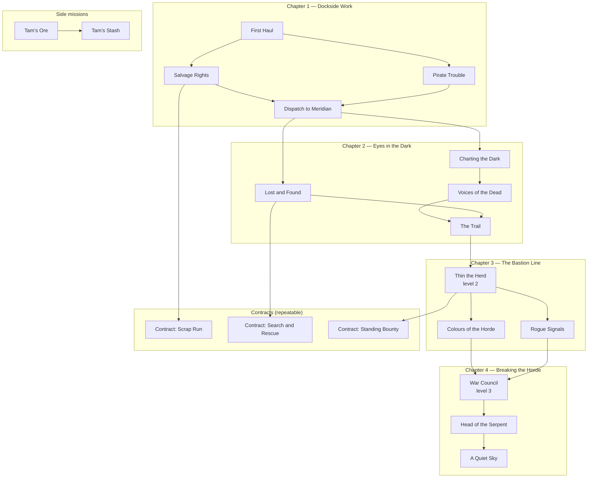

# Missions — reference and manual test guide

> Generated by `npm run quest-doc` from the definitions in `src/shared/quests/` and the English texts in
> `src/locales/en.json` (namespace `quests`). Do not edit this file by hand: change the definitions and run
> the generator again. The unit test `src/__tests__/unit/quests/questDoc.test.ts` fails when the file is out of date.

The game has 19 missions: 14 story missions in 4 chapters, 2 side missions and 3 repeatable contracts, offered by 4 contacts. On top of that there are 11 achievements and 8 locations to discover.

## Contents

1. [How missions work](#1-how-missions-work)
2. [Test tools](#2-test-tools)
3. [Overview](#3-overview)
4. [The sector](#4-the-sector)
5. [Missions in detail](#5-missions-in-detail)
6. [Achievements](#6-achievements)

## 1. How missions work

- **Contacts** are friendly ships that circle a station or landmark. A contact can be hailed while the player's ship is within 500 of the contact's ship: click the ship on the map (touch devices: tap it again when the tooltip says “tap again to hail”), or use the hail button of the mission tracker on the game page. Hailing opens the Missions page (`/missions`) with the contact's offers and open reports. Contacts cannot be attacked.
- **Accepting** a mission needs its giver in hailing range, all required missions completed and, for some missions, a minimum player level. Any number of missions can be active at the same time.
- A mission consists of one or more **steps**. A step lists objectives and usually a contact to report to. A step without a contact finishes by itself as soon as its objectives are fulfilled; otherwise the player has to hail the contact and report in. The contact of a step is not always the giver of the mission.
- **Objectives**: collect asteroids / shipwrecks / escape pods, defeat hostile NPC ships, fly to a location, or have mission cargo aboard. Counters only count while the step is active — a pirate defeated before accepting the mission does not count.
- **Mission cargo** lies in the ship inventory, one stack (one slot) per cargo type. It is either handed over by a contact or found while the step that asks for it is active. It cannot be discarded or sold, is handed over when the step is reported and is removed when the mission is abandoned. If the inventory is full, a find is lost and the player is told to free a slot.
- **Locations** are visited by flying within their radius while the game page is open (the check runs with the regular world update, not while the player is in a battle).
- Visiting a location for the first time discovers it and is worth 25 XP, with or without a mission.
- **Rewards** are paid when the last step is reported: XP, iron (limited by the iron storage capacity — iron above the capacity is lost) and sometimes a random commander, which needs a free inventory slot at that moment.
- **Abandoning** an active mission deletes its progress and its cargo. It can be accepted again from its giver.
- **Contracts** are repeatable: after completion they are on offer again.
- **Hostile ships** exist once per player; other players do not see or fight them. Aggressive ships open fire on a player ship that comes within their attack range. After every battle against an NPC ship the player is safe from ambushes for 90 seconds. A player who loses against an NPC ship loses all iron aboard.
- Every change (accepted, step finished, cargo found, location discovered, achievement unlocked, ambush) is sent to the player as a message. The Missions page also shows the answer to an action directly, and the contact's closing words when a mission is completed.

## 2. Test tools

Developer accounts (see `src/shared/adminAccess.ts`) get shortcuts on the Missions page, so a mission can be tested without playing everything before it. They call `POST /api/admin/quests`.

| Tool | Where | What it does |
| --- | --- | --- |
| Force accept | Mission card (missions that are not active) | Marks all required missions as completed (without their XP, iron or commander; they count for the achievements) and accepts the mission, regardless of player level and distance to the giver. A completed story or side mission cannot be accepted again — reset first. |
| Fulfil step | Mission card (active missions) | Fulfils the objectives of the current step: counters are set to their target and missing mission cargo is put into the inventory. A step with a contact still has to be reported. |
| Force report | Mission card (active missions) | Fulfils the current step and reports it to its contact from any distance. Click it once per step to walk through a mission; the last click pays the reward. |
| Reset all mission progress | “🛠 Test tools (developers only)”, a collapsed box at the top of the Missions page | Deletes all missions, counters, achievements, discovered locations and mission cargo of the account. XP, iron and commanders that were already paid stay. |
| Respawn hostile ships | Test tools | Brings back all defeated hostile ships of the account. Not possible while one of them is in a battle. |
| Jump to | Test tools | Puts the ship next to a contact or into the centre of a location and stops it. Not possible during a battle. Jumping to Horde’s Reach or the Anvil Graveyard lands inside the patrols. |

A typical test of one mission: **Reset** (optional) → **Force accept** on the mission card (Story tab) → play the step or click **Fulfil step** → fly to the contact (or **Jump to**) and report, or click **Force report**. The tables in [section 5](#5-missions-in-detail) list both ways for every mission.

The level requirement only applies to the normal “Accept mission” button. The seeded developer account `a` (password `a`) can be used on a development system.

## 3. Overview

### Dependencies

An arrow means “must be completed before”. A mission with several incoming arrows needs all of them.

### All missions

In an order in which they can be played. The checkbox column is for a manual test run.

| Tested | Mission | Type | Giver | Requires | Steps | Reward |
| --- | --- | --- | --- | --- | --- | --- |
| ☐ | [First Haul](#c1_first_haul) | Story, chapter 1 | Quartermaster Vess | — | 1 | 150 XP, 500 iron |
| ☐ | [Salvage Rights](#c1_salvage_rights) | Story, chapter 1 | Quartermaster Vess | First Haul | 1 | 200 XP, 800 iron |
| ☐ | [Pirate Trouble](#c1_pirate_trouble) | Story, chapter 1 | Quartermaster Vess | First Haul | 1 | 300 XP, 1500 iron |
| ☐ | [Dispatch to Meridian](#c1_dispatch_to_meridian) | Story, chapter 1 | Quartermaster Vess | Salvage Rights, Pirate Trouble | 1 | 250 XP, 500 iron |
| ☐ | [Charting the Dark](#c2_charting_the_dark) | Story, chapter 2 | Professor Quill | Dispatch to Meridian | 1 | 350 XP, 1000 iron |
| ☐ | [Lost and Found](#c2_lost_and_found) | Story, chapter 2 | Professor Quill | Dispatch to Meridian | 1 | 300 XP, 800 iron |
| ☐ | [Voices of the Dead](#c2_voices_of_the_dead) | Story, chapter 2 | Professor Quill | Charting the Dark | 2 | 450 XP, 1500 iron |
| ☐ | [The Trail](#c2_the_trail) | Story, chapter 2 | Professor Quill | Voices of the Dead, Lost and Found | 2 | 500 XP, 1500 iron |
| ☐ | [Thin the Herd](#c3_thin_the_herd) | Story, chapter 3 | Captain Halden | The Trail, level 2 | 1 | 500 XP, 3000 iron |
| ☐ | [Colours of the Horde](#c3_colours_of_the_horde) | Story, chapter 3 | Captain Halden | Thin the Herd | 1 | 600 XP, 4000 iron |
| ☐ | [Rogue Signals](#c3_rogue_signals) | Story, chapter 3 | Captain Halden | Thin the Herd | 1 | 500 XP, 2500 iron |
| ☐ | [War Council](#c4_war_council) | Story, chapter 4 | Captain Halden | Colours of the Horde, Rogue Signals, level 3 | 3 | 400 XP, 2000 iron |
| ☐ | [Head of the Serpent](#c4_head_of_the_serpent) | Story, chapter 4 | Captain Halden | War Council | 1 | 1500 XP, 10000 iron, a random commander |
| ☐ | [A Quiet Sky](#c4_a_quiet_sky) | Story, chapter 4 | Quartermaster Vess | Head of the Serpent | 1 | 500 XP, 3000 iron |
| ☐ | [Tam’s Ore](#side_tams_ore) | Side mission | Old Tam | — | 1 | 300 XP, 1200 iron |
| ☐ | [Tam’s Stash](#side_tams_stash) | Side mission | Old Tam | Tam’s Ore | 3 | 350 XP, a random commander |
| ☐ | [Contract: Scrap Run](#contract_scrap_run) | Contract (repeatable) | Quartermaster Vess | Salvage Rights | 1 | 100 XP, 600 iron |
| ☐ | [Contract: Search and Rescue](#contract_search_and_rescue) | Contract (repeatable) | Professor Quill | Lost and Found | 1 | 150 XP, 500 iron |
| ☐ | [Contract: Standing Bounty](#contract_standing_bounty) | Contract (repeatable) | Captain Halden | Thin the Herd | 1 | 250 XP, 2500 iron |

Total of all missions completed once: 7650 XP and 37400 iron, plus 2 commanders.

## 4. The sector

### Contacts

| Contact | Role | Ship | Circles | Orbit radius | Offers |
| --- | --- | --- | --- | --- | --- |
| Quartermaster Vess (`vess`) | Dock quartermaster of Ironstrike Station | ISV Ledger | Ironstrike Station (4000, 4000) | 320 | First Haul, Salvage Rights, Pirate Trouble, Dispatch to Meridian, A Quiet Sky, Contract: Scrap Run |
| Professor Quill (`quill`) | Head of research at Meridian Observatory | RV Meridian Lantern | Meridian Observatory (900, 1100) | 300 | Charting the Dark, Lost and Found, Voices of the Dead, The Trail, Contract: Search and Rescue |
| Captain Halden (`halden`) | Commander of the Bastion Outpost patrol | PC Bastion Vigil | Bastion Outpost (1200, 3900) | 340 | Thin the Herd, Colours of the Horde, Rogue Signals, War Council, Head of the Serpent, Contract: Standing Bounty |
| Old Tam (`tam`) | Prospector, hermit and owner of Drifter’s Rock | Rustbucket | Drifter’s Rock (4500, 800) | 150 | Tam’s Ore, Tam’s Stash |

### Locations

| Location | Kind | Position | Radius | Description |
| --- | --- | --- | --- | --- |
| Ironstrike Station (`ironstrike_station`) | station | (4000, 4000) | 500 | Trade hub of the sector. Its docks buy and sell commanders; Iron Horde pirates circle it. |
| Meridian Observatory (`meridian_observatory`) | station | (900, 1100) | 500 | Research station in the north-west that listens to everything that moves in the sector. |
| Bastion Outpost (`bastion_outpost`) | station | (1200, 3900) | 500 | Fortified patrol base in the south-west, the last line against the Iron Horde. |
| Horde’s Reach (`hordes_reach`) | lair | (2900, 1300) | 800 | Hideout of the Iron Horde. Marauders patrol it and attack every ship that comes too close. |
| Anvil Graveyard (`anvil_graveyard`) | wreck field | (2500, 3400) | 650 | Wreck field of a forgotten battle south of the sector's centre, still guarded by rogue sentry drones. |
| Azure Drift (`azure_drift`) | landmark | (300, 2700) | 300 | A cloud of cold blue ice crystals at the western edge. Beautiful and harmless. |
| Listening Post Tau (`listening_post_tau`) | landmark | (3500, 2300) | 300 | An abandoned relay station that sometimes transmits although nobody lives there. |
| Drifter’s Rock (`drifters_rock`) | landmark | (4500, 800) | 400 | A hollowed-out asteroid in the north-east, home of Old Tam. |

The three stations are starbases: the ship can dock there and trade commanders. All stations use the same picture for now.

### Hostile ships

Each player has their own set. The level of a ship is the player level plus the listed offset (at least 1).

| Ship | Behaviour | Circles | Orbit radius | Ships (level offset) | Strength | Iron for a victory | Returns |
| --- | --- | --- | --- | --- | --- | --- | --- |
| Iron Horde Pirate (`pirate`) | Passive: never attacks first | Ironstrike Station (4000, 4000) | 750 | 4 (±0, +1, +2, +3) | ×1 | 5000 × ship level | at midnight (UTC) |
| Iron Horde Marauder (`marauder`) | Aggressive: attacks a player ship within 300 of it | Horde’s Reach (2900, 1300) | 450 | 3 (−1, ±0, +1) | ×1 | 6000 × ship level | 20 min after its defeat |
| Rogue Sentry Drone (`drone`) | Aggressive: attacks a player ship within 220 of it | Anvil Graveyard (2500, 3400) | 380 | 2 (−1, ±0) | ×0.7 | 3000 × ship level | 15 min after its defeat |
| Warlord Krag (`warlord`) | Passive: never attacks first. Only present while an active mission step asks for it | Horde’s Reach (2900, 1300) | 150 | 1 (+2) | ×1.5 | 10000 × ship level | 10 min after its defeat |

### Mission cargo

| Cargo | Mission | Source | Description |
| --- | --- | --- | --- |
| Hull Plating (`hull_plating`) | Salvage Rights | Found when salvaging shipwrecks (100% chance each). | Reusable armour plates cut out of a shipwreck. |
| Sealed Dispatch (`sealed_dispatch`) | Dispatch to Meridian | Handed over when the mission step starts. | A sealed data cylinder from Quartermaster Vess, addressed to Professor Quill. |
| Flight Recorder (`flight_recorder`) | Voices of the Dead | Found when salvaging shipwrecks (100% chance each). | The black box of a destroyed ship. |
| Decoded Coordinates (`decoded_coordinates`) | The Trail | Handed over when the mission step starts. | Professor Quill’s analysis: the position of the Iron Horde’s hideout. |
| Horde Insignia (`horde_insignia`) | Colours of the Horde | Dropped by: Iron Horde Marauder (100% chance each). | The warlord’s emblem, cut from the hull of a marauder. |
| Drone Core (`drone_core`) | Rogue Signals | Dropped by: Rogue Sentry Drone (100% chance each). | The control core of a rogue sentry drone. |
| Battle Plans (`battle_plans`) | War Council | Handed over when the mission step starts. | Captain Halden’s plan for the strike on Horde’s Reach. |
| Warlord’s Cipher (`warlord_cipher`) | Head of the Serpent | Dropped by: Warlord Krag (100% chance each). | Krag’s command cipher, the key to the comm network of the Horde. |
| Ore Sample (`ore_sample`) | Tam’s Ore | Found when collecting asteroids (50% chance each). | A lump of bluish iron ore from an asteroid. |

## 5. Missions in detail

Each mission has a table “Manual test”: the actions of a normal playthrough, the test tool that replaces the action, and what the game answers. The expected messages are produced by the game rules themselves. In a real playthrough additional messages can appear: every piece of mission cargo found, locations discovered on the way and achievements.

### Chapter 1 — Dockside Work

Earn your place on the dock ledger of Ironstrike Station — and find out who keeps circling it.

#### First Haul (`c1_first_haul`)

|  |  |
| --- | --- |
| Type | Story, chapter 1 |
| Offered by | Quartermaster Vess — ISV Ledger, near Ironstrike Station (4000, 4000) |
| Requires | — |
| Unlocks | Salvage Rights, Pirate Trouble |
| Reward | 150 XP, 500 iron |

Offer: *New in the sector? Then show me you can fly. The smelters of the station are running dry — bring in three asteroids and I will put your name on the dock ledger.*

| Step | Briefing | Objectives | Handed over at the start | Finished by |
| --- | --- | --- | --- | --- |
| 1 | Collect 3 asteroids, then report to Quartermaster Vess. | Collect asteroids ×3 | — | report to Quartermaster Vess |

Completion: *Three rocks and not a dent in your hull. You are on the ledger, pilot. There is more work where that came from.*

**Manual test**

| # | Action | Shortcut | Expected |
| --- | --- | --- | --- |
| 1 | Fly within 500 of the ISV Ledger, hail Quartermaster Vess and accept the mission | Force accept | Message “📜 Mission accepted: **First Haul**” |
| 2 | Step 1: Collect asteroids ×3 | Fulfil step | Message “📜 **First Haul**: objectives fulfilled. Report to **Quartermaster Vess**.” |
| 3 | Step 1: fly within 500 of the ISV Ledger and report to Quartermaster Vess | Force report | Message “🏅 Mission completed: **First Haul**! Reward: 150 XP and 500 iron.” Now on offer (if their other requirements are met): Salvage Rights, Pirate Trouble |

#### Salvage Rights (`c1_salvage_rights`)

|  |  |
| --- | --- |
| Type | Story, chapter 1 |
| Offered by | Quartermaster Vess — ISV Ledger, near Ironstrike Station (4000, 4000) |
| Requires | First Haul (`c1_first_haul`) |
| Unlocks | Dispatch to Meridian, Contract: Scrap Run |
| Reward | 200 XP, 800 iron |
| Mission cargo | Hull Plating: Found when salvaging shipwrecks (100% chance each). |

Offer: *The wrecks drifting out there still carry good plating. Cut two hull plates out of shipwrecks and the docks will pay for them — legally, for once.*

| Step | Briefing | Objectives | Handed over at the start | Finished by |
| --- | --- | --- | --- | --- |
| 1 | Salvage shipwrecks until you have 2 hull plates, then bring them to Quartermaster Vess. | Have aboard: Hull Plating ×2 | — | report to Quartermaster Vess |

Completion: *Solid plating, the repair crews will bless you. The salvage rights are yours — from now on I have regular scrap runs for you.*

**Manual test**

| # | Action | Shortcut | Expected |
| --- | --- | --- | --- |
| 1 | Fly within 500 of the ISV Ledger, hail Quartermaster Vess and accept the mission | Force accept | Message “📜 Mission accepted: **Salvage Rights**” |
| 2 | Step 1: Have aboard: Hull Plating ×2 — Found when salvaging shipwrecks (100% chance each). | Fulfil step | Message “📜 **Salvage Rights**: objectives fulfilled. Report to **Quartermaster Vess**.” |
| 3 | Step 1: fly within 500 of the ISV Ledger and report to Quartermaster Vess | Force report | Message “🏅 Mission completed: **Salvage Rights**! Reward: 200 XP and 800 iron.” Inventory: − 2× Hull Plating Now on offer (if their other requirements are met): Dispatch to Meridian, Contract: Scrap Run |

#### Pirate Trouble (`c1_pirate_trouble`)

|  |  |
| --- | --- |
| Type | Story, chapter 1 |
| Offered by | Quartermaster Vess — ISV Ledger, near Ironstrike Station (4000, 4000) |
| Requires | First Haul (`c1_first_haul`) |
| Unlocks | Dispatch to Meridian |
| Reward | 300 XP, 1500 iron |

Offer: *See the ships circling the station? Iron Horde. They pick off everybody who leaves with a full hold. Take one of them down and show them that this dock is defended.*

| Step | Briefing | Objectives | Handed over at the start | Finished by |
| --- | --- | --- | --- | --- |
| 1 | Defeat 1 Iron Horde Pirate near Ironstrike Station, then report to Quartermaster Vess. | Defeat: Iron Horde Pirate ×1 | — | report to Quartermaster Vess |

Completion: *One vulture less above my docks. They will be back at midnight, they always are — but now they know your name.*

**Manual test**

| # | Action | Shortcut | Expected |
| --- | --- | --- | --- |
| 1 | Fly within 500 of the ISV Ledger, hail Quartermaster Vess and accept the mission | Force accept | Message “📜 Mission accepted: **Pirate Trouble**” |
| 2 | Step 1: Defeat: Iron Horde Pirate ×1 — circles Ironstrike Station (4000, 4000) at a distance of 750, never attacks first | Fulfil step | Message “📜 **Pirate Trouble**: objectives fulfilled. Report to **Quartermaster Vess**.” |
| 3 | Step 1: fly within 500 of the ISV Ledger and report to Quartermaster Vess | Force report | Message “🏅 Mission completed: **Pirate Trouble**! Reward: 300 XP and 1500 iron.” Now on offer (if their other requirements are met): Dispatch to Meridian |

#### Dispatch to Meridian (`c1_dispatch_to_meridian`)

|  |  |
| --- | --- |
| Type | Story, chapter 1 |
| Offered by | Quartermaster Vess — ISV Ledger, near Ironstrike Station (4000, 4000) |
| Requires | Salvage Rights (`c1_salvage_rights`), Pirate Trouble (`c1_pirate_trouble`) |
| Unlocks | Charting the Dark, Lost and Found |
| Reward | 250 XP, 500 iron |
| Mission cargo | Sealed Dispatch: Handed over when the mission step starts. |

Offer: *The Horde has never been this organised, and I want to know why. Professor Quill at Meridian Observatory listens to everything that moves out here. Take this sealed dispatch to the Meridian Lantern — and do not open it.*

| Step | Briefing | Objectives | Handed over at the start | Finished by |
| --- | --- | --- | --- | --- |
| 1 | Carry the sealed dispatch to Professor Quill at Meridian Observatory. | Have aboard: Sealed Dispatch ×1 | 1× Sealed Dispatch | report to Professor Quill |

Completion: *A dispatch from Vess? Hm. Pirate sightings, lost convoys… this matches my readings uncomfortably well. Stay a while, pilot. I have work for a curious ship.*

**Manual test**

| # | Action | Shortcut | Expected |
| --- | --- | --- | --- |
| 1 | Fly within 500 of the ISV Ledger, hail Quartermaster Vess and accept the mission | Force accept | Message “📜 Mission accepted: **Dispatch to Meridian**” Inventory: + 1× Sealed Dispatch |
| 2 | Step 1: fly within 500 of the RV Meridian Lantern and report to Professor Quill | Force report | Message “🏅 Mission completed: **Dispatch to Meridian**! Reward: 250 XP and 500 iron.” Inventory: − 1× Sealed Dispatch Now on offer (if their other requirements are met): Charting the Dark, Lost and Found |

### Chapter 2 — Eyes in the Dark

Professor Quill of Meridian Observatory follows strange signals to the hiding place of the Iron Horde.

#### Charting the Dark (`c2_charting_the_dark`)

|  |  |
| --- | --- |
| Type | Story, chapter 2 |
| Offered by | Professor Quill — RV Meridian Lantern, near Meridian Observatory (900, 1100) |
| Requires | Dispatch to Meridian (`c1_dispatch_to_meridian`) |
| Unlocks | Voices of the Dead |
| Reward | 350 XP, 1000 iron |

Offer: *My instruments show two anomalies I cannot explain from here: a cold blue cloud in the west and a dead transmitter that is occasionally not dead at all. Fly to the Azure Drift and to Listening Post Tau and let your sensors do the rest.*

| Step | Briefing | Objectives | Handed over at the start | Finished by |
| --- | --- | --- | --- | --- |
| 1 | Fly to the Azure Drift and to Listening Post Tau, then report to Professor Quill. | Fly to Azure Drift (300, 2700); Fly to Listening Post Tau (3500, 2300) | — | report to Professor Quill |

Completion: *Splendid data! The Drift is harmless — beautiful, but harmless. Tau, however, has been relaying signals for somebody. Somebody who did not build it.*

**Manual test**

| # | Action | Shortcut | Expected |
| --- | --- | --- | --- |
| 1 | Fly within 500 of the RV Meridian Lantern, hail Professor Quill and accept the mission | Force accept | Message “📜 Mission accepted: **Charting the Dark**” |
| 2 | Step 1: Fly to Azure Drift (300, 2700) — counts within 300 of the centre, with the game page open; Fly to Listening Post Tau (3500, 2300) — counts within 300 of the centre, with the game page open | Fulfil step | Message “📜 **Charting the Dark**: objectives fulfilled. Report to **Professor Quill**.” |
| 3 | Step 1: fly within 500 of the RV Meridian Lantern and report to Professor Quill | Force report | Message “🏅 Mission completed: **Charting the Dark**! Reward: 350 XP and 1000 iron.” Now on offer (if their other requirements are met): Voices of the Dead |

#### Lost and Found (`c2_lost_and_found`)

|  |  |
| --- | --- |
| Type | Story, chapter 2 |
| Offered by | Professor Quill — RV Meridian Lantern, near Meridian Observatory (900, 1100) |
| Requires | Dispatch to Meridian (`c1_dispatch_to_meridian`) |
| Unlocks | The Trail, Contract: Search and Rescue |
| Reward | 300 XP, 800 iron |

Offer: *Every week another crew ends up in an escape pod. They are the only witnesses we have. Recover two pods and bring me what the survivors saw.*

| Step | Briefing | Objectives | Handed over at the start | Finished by |
| --- | --- | --- | --- | --- |
| 1 | Recover 2 escape pods, then report to Professor Quill. | Recover escape pods ×2 | — | report to Professor Quill |

Completion: *They all tell the same story: ships with red prows, striking from the north-east. Thank you — the crews are in good hands now.*

**Manual test**

| # | Action | Shortcut | Expected |
| --- | --- | --- | --- |
| 1 | Fly within 500 of the RV Meridian Lantern, hail Professor Quill and accept the mission | Force accept | Message “📜 Mission accepted: **Lost and Found**” |
| 2 | Step 1: Recover escape pods ×2 | Fulfil step | Message “📜 **Lost and Found**: objectives fulfilled. Report to **Professor Quill**.” |
| 3 | Step 1: fly within 500 of the RV Meridian Lantern and report to Professor Quill | Force report | Message “🏅 Mission completed: **Lost and Found**! Reward: 300 XP and 800 iron.” Now on offer (if their other requirements are met): The Trail, Contract: Search and Rescue |

#### Voices of the Dead (`c2_voices_of_the_dead`)

|  |  |
| --- | --- |
| Type | Story, chapter 2 |
| Offered by | Professor Quill — RV Meridian Lantern, near Meridian Observatory (900, 1100) |
| Requires | Charting the Dark (`c2_charting_the_dark`) |
| Unlocks | The Trail |
| Reward | 450 XP, 1500 iron |
| Mission cargo | Flight Recorder: Found when salvaging shipwrecks (100% chance each). |

Offer: *The relayed signals point to the Anvil Graveyard, the wreck field south of the sector's centre. Old sentry drones still guard it and they shoot at everything. Scout the field first, then pull three flight recorders out of shipwrecks.*

| Step | Briefing | Objectives | Handed over at the start | Finished by |
| --- | --- | --- | --- | --- |
| 1 | Scout the Anvil Graveyard. | Fly to Anvil Graveyard (2500, 3400) | — | objectives fulfilled (no report) |
| 2 | Salvage shipwrecks until you have 3 flight recorders, then bring them to Professor Quill. | Have aboard: Flight Recorder ×3 | — | report to Professor Quill |

Completion: *Listen to this… the last entries all mention one name: Krag. A warlord who is forging the pirate clans into a single Iron Horde. We have to find out where he sits.*

**Manual test**

| # | Action | Shortcut | Expected |
| --- | --- | --- | --- |
| 1 | Fly within 500 of the RV Meridian Lantern, hail Professor Quill and accept the mission | Force accept | Message “📜 Mission accepted: **Voices of the Dead**” |
| 2 | Step 1: Fly to Anvil Graveyard (2500, 3400) — counts within 650 of the centre, with the game page open | Fulfil step | Message “📜 **Voices of the Dead** — next step: Salvage shipwrecks until you have 3 flight recorders, then bring them to Professor Quill.” |
| 3 | Step 2: Have aboard: Flight Recorder ×3 — Found when salvaging shipwrecks (100% chance each). | Fulfil step | Message “📜 **Voices of the Dead**: objectives fulfilled. Report to **Professor Quill**.” |
| 4 | Step 2: fly within 500 of the RV Meridian Lantern and report to Professor Quill | Force report | Message “🏅 Mission completed: **Voices of the Dead**! Reward: 450 XP and 1500 iron.” Inventory: − 3× Flight Recorder Now on offer (if their other requirements are met): The Trail |

#### The Trail (`c2_the_trail`)

|  |  |
| --- | --- |
| Type | Story, chapter 2 |
| Offered by | Professor Quill — RV Meridian Lantern, near Meridian Observatory (900, 1100) |
| Requires | Voices of the Dead (`c2_voices_of_the_dead`), Lost and Found (`c2_lost_and_found`) |
| Unlocks | Thin the Herd |
| Reward | 500 XP, 1500 iron |
| Mission cargo | Decoded Coordinates: Handed over when the mission step starts. |

Offer: *The recorders give me a bearing, north-east of the Graveyard. If the Horde has a hideout, it is there. Get close enough for a sensor sweep — and no closer. Their marauders attack on sight.*

| Step | Briefing | Objectives | Handed over at the start | Finished by |
| --- | --- | --- | --- | --- |
| 1 | Scout Horde’s Reach, then report to Professor Quill. | Fly to Horde’s Reach (2900, 1300) | — | report to Professor Quill |
| 2 | Carry the decoded coordinates to Captain Halden at Bastion Outpost. | Have aboard: Decoded Coordinates ×1 | 1× Decoded Coordinates | report to Captain Halden |

Completion: *So that is where they have been hiding. The professor does good work, and so do you. Bastion has been waiting for a pilot who does not run. Welcome to the line.*

**Manual test**

| # | Action | Shortcut | Expected |
| --- | --- | --- | --- |
| 1 | Fly within 500 of the RV Meridian Lantern, hail Professor Quill and accept the mission | Force accept | Message “📜 Mission accepted: **The Trail**” |
| 2 | Step 1: Fly to Horde’s Reach (2900, 1300) — counts within 800 of the centre, with the game page open | Fulfil step | Message “📜 **The Trail**: objectives fulfilled. Report to **Professor Quill**.” |
| 3 | Step 1: fly within 500 of the RV Meridian Lantern and report to Professor Quill | Force report | Message “📜 **The Trail** — next step: Carry the decoded coordinates to Captain Halden at Bastion Outpost.” Message “📜 **The Trail**: objectives fulfilled. Report to **Captain Halden**.” Inventory: + 1× Decoded Coordinates |
| 4 | Step 2: fly within 500 of the PC Bastion Vigil and report to Captain Halden | Force report | Message “🏅 Mission completed: **The Trail**! Reward: 500 XP and 1500 iron.” Inventory: − 1× Decoded Coordinates Now on offer (if their other requirements are met): Thin the Herd |

### Chapter 3 — The Bastion Line

Captain Halden of Bastion Outpost takes the fight to the Horde’s raiders, marauders and hijacked drones.

#### Thin the Herd (`c3_thin_the_herd`)

|  |  |
| --- | --- |
| Type | Story, chapter 3 |
| Offered by | Captain Halden — PC Bastion Vigil, near Bastion Outpost (1200, 3900) |
| Requires | The Trail (`c2_the_trail`), player level 2 |
| Unlocks | Colours of the Horde, Rogue Signals, Contract: Standing Bounty |
| Reward | 500 XP, 3000 iron |

Offer: *Before we can touch their hideout, the raiders around Ironstrike have to learn fear. Destroy three Iron Horde pirates. Take your time — they return every midnight, and so can you.*

| Step | Briefing | Objectives | Handed over at the start | Finished by |
| --- | --- | --- | --- | --- |
| 1 | Defeat 3 Iron Horde Pirates, then report to Captain Halden. | Defeat: Iron Horde Pirate ×3 | — | report to Captain Halden |

Completion: *Three confirmed. The raids on the station are getting thinner already. Now we go after the ones who matter.*

**Manual test**

| # | Action | Shortcut | Expected |
| --- | --- | --- | --- |
| 1 | Fly within 500 of the PC Bastion Vigil, hail Captain Halden and accept the mission | Force accept | Message “📜 Mission accepted: **Thin the Herd**” |
| 2 | Step 1: Defeat: Iron Horde Pirate ×3 — circles Ironstrike Station (4000, 4000) at a distance of 750, never attacks first | Fulfil step | Message “📜 **Thin the Herd**: objectives fulfilled. Report to **Captain Halden**.” |
| 3 | Step 1: fly within 500 of the PC Bastion Vigil and report to Captain Halden | Force report | Message “🏅 Mission completed: **Thin the Herd**! Reward: 500 XP and 3000 iron.” Now on offer (if their other requirements are met): Colours of the Horde, Rogue Signals, Contract: Standing Bounty |

#### Colours of the Horde (`c3_colours_of_the_horde`)

|  |  |
| --- | --- |
| Type | Story, chapter 3 |
| Offered by | Captain Halden — PC Bastion Vigil, near Bastion Outpost (1200, 3900) |
| Requires | Thin the Herd (`c3_thin_the_herd`) |
| Unlocks | War Council |
| Reward | 600 XP, 4000 iron |
| Mission cargo | Horde Insignia: Dropped by: Iron Horde Marauder (100% chance each). |

Offer: *The marauders guarding Horde’s Reach wear the insignia of the warlord. Bring me two of them. They will come for you the moment you cross their patrol line, so be ready when you do.*

| Step | Briefing | Objectives | Handed over at the start | Finished by |
| --- | --- | --- | --- | --- |
| 1 | Defeat Iron Horde Marauders at Horde’s Reach until you have 2 Horde insignia, then bring them to Captain Halden. | Have aboard: Horde Insignia ×2 | — | report to Captain Halden |

Completion: *Krag’s own colours. Each of these opens a door in their comm network. Good fighting, pilot.*

**Manual test**

| # | Action | Shortcut | Expected |
| --- | --- | --- | --- |
| 1 | Fly within 500 of the PC Bastion Vigil, hail Captain Halden and accept the mission | Force accept | Message “📜 Mission accepted: **Colours of the Horde**” |
| 2 | Step 1: Have aboard: Horde Insignia ×2 — Dropped by: Iron Horde Marauder (100% chance each). | Fulfil step | Message “📜 **Colours of the Horde**: objectives fulfilled. Report to **Captain Halden**.” |
| 3 | Step 1: fly within 500 of the PC Bastion Vigil and report to Captain Halden | Force report | Message “🏅 Mission completed: **Colours of the Horde**! Reward: 600 XP and 4000 iron.” Inventory: − 2× Horde Insignia Now on offer (if their other requirements are met): War Council |

#### Rogue Signals (`c3_rogue_signals`)

|  |  |
| --- | --- |
| Type | Story, chapter 3 |
| Offered by | Captain Halden — PC Bastion Vigil, near Bastion Outpost (1200, 3900) |
| Requires | Thin the Herd (`c3_thin_the_herd`) |
| Unlocks | War Council |
| Reward | 500 XP, 2500 iron |
| Mission cargo | Drone Core: Dropped by: Rogue Sentry Drone (100% chance each). |

Offer: *The sentry drones of the Anvil Graveyard have started relaying for the Horde. Quill believes their cores can be turned against them. Take down drones and bring two cores to the professor.*

| Step | Briefing | Objectives | Handed over at the start | Finished by |
| --- | --- | --- | --- | --- |
| 1 | Defeat Rogue Sentry Drones at the Anvil Graveyard until you have 2 drone cores, then bring them to Professor Quill. | Have aboard: Drone Core ×2 | — | report to Professor Quill |

Completion: *Intact cores! With these I can read the patrol schedule of the Horde like a timetable. Tell Halden that the Observatory is ready.*

**Manual test**

| # | Action | Shortcut | Expected |
| --- | --- | --- | --- |
| 1 | Fly within 500 of the PC Bastion Vigil, hail Captain Halden and accept the mission | Force accept | Message “📜 Mission accepted: **Rogue Signals**” |
| 2 | Step 1: Have aboard: Drone Core ×2 — Dropped by: Rogue Sentry Drone (100% chance each). | Fulfil step | Message “📜 **Rogue Signals**: objectives fulfilled. Report to **Professor Quill**.” |
| 3 | Step 1: fly within 500 of the RV Meridian Lantern and report to Professor Quill | Force report | Message “🏅 Mission completed: **Rogue Signals**! Reward: 500 XP and 2500 iron.” Inventory: − 2× Drone Core Now on offer (if their other requirements are met): War Council |

### Chapter 4 — Breaking the Horde

Unite the sector, hunt down Warlord Krag and bring quiet back to the sky.

#### War Council (`c4_war_council`)

|  |  |
| --- | --- |
| Type | Story, chapter 4 |
| Offered by | Captain Halden — PC Bastion Vigil, near Bastion Outpost (1200, 3900) |
| Requires | Colours of the Horde (`c3_colours_of_the_horde`), Rogue Signals (`c3_rogue_signals`), player level 3 |
| Unlocks | Head of the Serpent |
| Reward | 400 XP, 2000 iron |
| Mission cargo | Battle Plans: Handed over when the mission step starts. |

Offer: *We have their colours, their schedule and their hideout. Now I need the sector behind me. Take these battle plans to Vess — the station has to supply the strike — and then to Quill for the timing. Bring them back countersigned.*

| Step | Briefing | Objectives | Handed over at the start | Finished by |
| --- | --- | --- | --- | --- |
| 1 | Take the battle plans to Quartermaster Vess at Ironstrike Station. | — | 1× Battle Plans | report to Quartermaster Vess |
| 2 | Take the battle plans to Professor Quill at Meridian Observatory. | — | — | report to Professor Quill |
| 3 | Return the countersigned battle plans to Captain Halden at Bastion Outpost. | Have aboard: Battle Plans ×1 | — | report to Captain Halden |

Completion: *Station and Observatory are both in. Then it is decided: we cut off the head of the serpent.*

**Manual test**

| # | Action | Shortcut | Expected |
| --- | --- | --- | --- |
| 1 | Fly within 500 of the PC Bastion Vigil, hail Captain Halden and accept the mission | Force accept | Message “📜 Mission accepted: **War Council**” Inventory: + 1× Battle Plans |
| 2 | Step 1: fly within 500 of the ISV Ledger and report to Quartermaster Vess | Force report | Message “📜 **War Council** — next step: Take the battle plans to Professor Quill at Meridian Observatory.” Message “📜 **War Council**: objectives fulfilled. Report to **Professor Quill**.” |
| 3 | Step 2: fly within 500 of the RV Meridian Lantern and report to Professor Quill | Force report | Message “📜 **War Council** — next step: Return the countersigned battle plans to Captain Halden at Bastion Outpost.” Message “📜 **War Council**: objectives fulfilled. Report to **Captain Halden**.” |
| 4 | Step 3: fly within 500 of the PC Bastion Vigil and report to Captain Halden | Force report | Message “🏅 Mission completed: **War Council**! Reward: 400 XP and 2000 iron.” Inventory: − 1× Battle Plans Now on offer (if their other requirements are met): Head of the Serpent |

#### Head of the Serpent (`c4_head_of_the_serpent`)

|  |  |
| --- | --- |
| Type | Story, chapter 4 |
| Offered by | Captain Halden — PC Bastion Vigil, near Bastion Outpost (1200, 3900) |
| Requires | War Council (`c4_war_council`) |
| Unlocks | A Quiet Sky |
| Reward | 1500 XP, 10000 iron, a random commander |
| Mission cargo | Warlord’s Cipher: Dropped by: Warlord Krag (100% chance each). |

Offer: *Warlord Krag has come out of hiding. His flagship circles the centre of Horde’s Reach, inside the marauder patrols. Destroy it and bring me his command cipher — without it the Horde falls apart.*

| Step | Briefing | Objectives | Handed over at the start | Finished by |
| --- | --- | --- | --- | --- |
| 1 | Defeat Warlord Krag at Horde’s Reach, take his cipher and bring it to Captain Halden. | Defeat: Warlord Krag ×1; Have aboard: Warlord’s Cipher ×1 | — | report to Captain Halden |

Completion: *Krag’s cipher. Without it the clans cannot talk to each other, and a Horde that cannot talk is a handful of thieves. One of my best officers has asked to fly with you — you have earned a crew like that.*

**Manual test**

| # | Action | Shortcut | Expected |
| --- | --- | --- | --- |
| 1 | Fly within 500 of the PC Bastion Vigil, hail Captain Halden and accept the mission | Force accept | Message “📜 Mission accepted: **Head of the Serpent**” |
| 2 | Step 1: Defeat: Warlord Krag ×1 — circles Horde’s Reach (2900, 1300) at a distance of 150, never attacks first; Have aboard: Warlord’s Cipher ×1 — Dropped by: Warlord Krag (100% chance each). | Fulfil step | Message “📜 **Head of the Serpent**: objectives fulfilled. Report to **Captain Halden**.” |
| 3 | Step 1: fly within 500 of the PC Bastion Vigil and report to Captain Halden | Force report | Message “🏅 Mission completed: **Head of the Serpent**! Reward: 1500 XP, 10000 iron and a new commander.” Inventory: − 1× Warlord’s Cipher Inventory: + a random commander (needs a free slot) Now on offer (if their other requirements are met): A Quiet Sky |

#### A Quiet Sky (`c4_a_quiet_sky`)

|  |  |
| --- | --- |
| Type | Story, chapter 4 |
| Offered by | Quartermaster Vess — ISV Ledger, near Ironstrike Station (4000, 4000) |
| Requires | Head of the Serpent (`c4_head_of_the_serpent`) |
| Unlocks | — |
| Reward | 500 XP, 3000 iron |

Offer: *It is over, and the docks have not been this calm in years. Do me one last favour: fly the round, Meridian and Bastion, and tell them that Ironstrike keeps its ledger open for them. Then come home.*

| Step | Briefing | Objectives | Handed over at the start | Finished by |
| --- | --- | --- | --- | --- |
| 1 | Visit Meridian Observatory and Bastion Outpost, then return to Quartermaster Vess. | Fly to Meridian Observatory (900, 1100); Fly to Bastion Outpost (1200, 3900) | — | report to Quartermaster Vess |

Completion: *So that is the sector, safe for now. You started with three rocks, pilot. The ledger says you finished with a war. There will always be a contract here for you.*

**Manual test**

| # | Action | Shortcut | Expected |
| --- | --- | --- | --- |
| 1 | Fly within 500 of the ISV Ledger, hail Quartermaster Vess and accept the mission | Force accept | Message “📜 Mission accepted: **A Quiet Sky**” |
| 2 | Step 1: Fly to Meridian Observatory (900, 1100) — counts within 500 of the centre, with the game page open; Fly to Bastion Outpost (1200, 3900) — counts within 500 of the centre, with the game page open | Fulfil step | Message “📜 **A Quiet Sky**: objectives fulfilled. Report to **Quartermaster Vess**.” |
| 3 | Step 1: fly within 500 of the ISV Ledger and report to Quartermaster Vess | Force report | Message “🏅 Mission completed: **A Quiet Sky**! Reward: 500 XP and 3000 iron.” |

### Side missions

Old Tam of Drifter’s Rock has work that has nothing to do with the war.

#### Tam’s Ore (`side_tams_ore`)

|  |  |
| --- | --- |
| Type | Side mission |
| Offered by | Old Tam — Rustbucket, near Drifter’s Rock (4500, 800) |
| Requires | — |
| Unlocks | Tam’s Stash |
| Reward | 300 XP, 1200 iron |
| Mission cargo | Ore Sample: Found when collecting asteroids (50% chance each). |

Offer: *Old Tam smells blue iron in these asteroids, but his drill arm is not what it used to be. Crack rocks for me — about every second one carries a sample. Three samples and I pay honest.*

| Step | Briefing | Objectives | Handed over at the start | Finished by |
| --- | --- | --- | --- | --- |
| 1 | Collect asteroids until you have 3 ore samples, then bring them to Old Tam at Drifter’s Rock. | Have aboard: Ore Sample ×3 | — | report to Old Tam |

Completion: *Blue iron! Told them, I did, told them all. Here is your share. And maybe Tam has something better than iron for a pilot who keeps their word.*

**Manual test**

| # | Action | Shortcut | Expected |
| --- | --- | --- | --- |
| 1 | Fly within 500 of the Rustbucket, hail Old Tam and accept the mission | Force accept | Message “📜 Mission accepted: **Tam’s Ore**” |
| 2 | Step 1: Have aboard: Ore Sample ×3 — Found when collecting asteroids (50% chance each). | Fulfil step | Message “📜 **Tam’s Ore**: objectives fulfilled. Report to **Old Tam**.” |
| 3 | Step 1: fly within 500 of the Rustbucket and report to Old Tam | Force report | Message “🏅 Mission completed: **Tam’s Ore**! Reward: 300 XP and 1200 iron.” Inventory: − 3× Ore Sample Now on offer (if their other requirements are met): Tam’s Stash |

#### Tam’s Stash (`side_tams_stash`)

|  |  |
| --- | --- |
| Type | Side mission |
| Offered by | Old Tam — Rustbucket, near Drifter’s Rock (4500, 800) |
| Requires | Tam’s Ore (`side_tams_ore`) |
| Unlocks | — |
| Reward | 350 XP, a random commander |

Offer: *Years back I flew with a partner. We hid our best find where no pirate ever looks: follow the cold light first, then the dead ear. That is all the map I ever needed. Go and look, then come and tell old Tam what you saw.*

| Step | Briefing | Objectives | Handed over at the start | Finished by |
| --- | --- | --- | --- | --- |
| 1 | Follow the cold light: fly to the Azure Drift. | Fly to Azure Drift (300, 2700) | — | objectives fulfilled (no report) |
| 2 | Find the dead ear: fly to Listening Post Tau. | Fly to Listening Post Tau (3500, 2300) | — | objectives fulfilled (no report) |
| 3 | Return to Old Tam at Drifter’s Rock. | — | — | report to Old Tam |

Completion: *You found the pod? Still sealed? Ha! That is no treasure, pilot, that is my old partner in cold sleep — the best navigator who ever lived. Wake them gently. They fly with you now.*

**Manual test**

| # | Action | Shortcut | Expected |
| --- | --- | --- | --- |
| 1 | Fly within 500 of the Rustbucket, hail Old Tam and accept the mission | Force accept | Message “📜 Mission accepted: **Tam’s Stash**” |
| 2 | Step 1: Fly to Azure Drift (300, 2700) — counts within 300 of the centre, with the game page open | Fulfil step | Message “📜 **Tam’s Stash** — next step: Find the dead ear: fly to Listening Post Tau.” |
| 3 | Step 2: Fly to Listening Post Tau (3500, 2300) — counts within 300 of the centre, with the game page open | Fulfil step | Message “📜 **Tam’s Stash** — next step: Return to Old Tam at Drifter’s Rock.” Message “📜 **Tam’s Stash**: objectives fulfilled. Report to **Old Tam**.” |
| 4 | Step 3: fly within 500 of the Rustbucket and report to Old Tam | Force report | Message “🏅 Mission completed: **Tam’s Stash**! Reward: 350 XP and a new commander.” Inventory: + a random commander (needs a free slot) |

### Contracts

Repeatable work for iron and experience. A contract can be accepted again as soon as it is completed.

#### Contract: Scrap Run (`contract_scrap_run`)

|  |  |
| --- | --- |
| Type | Contract (repeatable) |
| Offered by | Quartermaster Vess — ISV Ledger, near Ironstrike Station (4000, 4000) |
| Requires | Salvage Rights (`c1_salvage_rights`) |
| Unlocks | — |
| Reward | 100 XP, 600 iron |

Offer: *The smelters never stop. Five asteroids and two shipwrecks, usual rate.*

| Step | Briefing | Objectives | Handed over at the start | Finished by |
| --- | --- | --- | --- | --- |
| 1 | Collect 5 asteroids and 2 shipwrecks, then report to Quartermaster Vess. | Collect asteroids ×5; Salvage shipwrecks ×2 | — | report to Quartermaster Vess |

Completion: *Weighed and paid. Come back whenever you need the work.*

**Manual test**

| # | Action | Shortcut | Expected |
| --- | --- | --- | --- |
| 1 | Fly within 500 of the ISV Ledger, hail Quartermaster Vess and accept the mission | Force accept | Message “📜 Mission accepted: **Contract: Scrap Run**” |
| 2 | Step 1: Collect asteroids ×5; Salvage shipwrecks ×2 | Fulfil step | Message “📜 **Contract: Scrap Run**: objectives fulfilled. Report to **Quartermaster Vess**.” |
| 3 | Step 1: fly within 500 of the ISV Ledger and report to Quartermaster Vess | Force report | Message “🏅 Mission completed: **Contract: Scrap Run**! Reward: 100 XP and 600 iron.” The contract is on offer again |

#### Contract: Search and Rescue (`contract_search_and_rescue`)

|  |  |
| --- | --- |
| Type | Contract (repeatable) |
| Offered by | Professor Quill — RV Meridian Lantern, near Meridian Observatory (900, 1100) |
| Requires | Lost and Found (`c2_lost_and_found`) |
| Unlocks | — |
| Reward | 150 XP, 500 iron |

Offer: *There are always more pods than rescuers. Recover three and the Observatory covers your fuel — and then some.*

| Step | Briefing | Objectives | Handed over at the start | Finished by |
| --- | --- | --- | --- | --- |
| 1 | Recover 3 escape pods, then report to Professor Quill. | Recover escape pods ×3 | — | report to Professor Quill |

Completion: *Three more crews breathing station air. Thank you, pilot.*

**Manual test**

| # | Action | Shortcut | Expected |
| --- | --- | --- | --- |
| 1 | Fly within 500 of the RV Meridian Lantern, hail Professor Quill and accept the mission | Force accept | Message “📜 Mission accepted: **Contract: Search and Rescue**” |
| 2 | Step 1: Recover escape pods ×3 | Fulfil step | Message “📜 **Contract: Search and Rescue**: objectives fulfilled. Report to **Professor Quill**.” |
| 3 | Step 1: fly within 500 of the RV Meridian Lantern and report to Professor Quill | Force report | Message “🏅 Mission completed: **Contract: Search and Rescue**! Reward: 150 XP and 500 iron.” The contract is on offer again |

#### Contract: Standing Bounty (`contract_standing_bounty`)

|  |  |
| --- | --- |
| Type | Contract (repeatable) |
| Offered by | Captain Halden — PC Bastion Vigil, near Bastion Outpost (1200, 3900) |
| Requires | Thin the Herd (`c3_thin_the_herd`) |
| Unlocks | — |
| Reward | 250 XP, 2500 iron |

Offer: *Bastion pays for every hostile hull. Pirates, marauders, drones — I do not care which. Three kills, one bounty.*

| Step | Briefing | Objectives | Handed over at the start | Finished by |
| --- | --- | --- | --- | --- |
| 1 | Defeat 3 hostile ships of any kind, then report to Captain Halden. | Defeat hostile ships of any kind ×3 | — | report to Captain Halden |

Completion: *Confirmed, the bounty is transferred. The line holds because of pilots like you.*

**Manual test**

| # | Action | Shortcut | Expected |
| --- | --- | --- | --- |
| 1 | Fly within 500 of the PC Bastion Vigil, hail Captain Halden and accept the mission | Force accept | Message “📜 Mission accepted: **Contract: Standing Bounty**” |
| 2 | Step 1: Defeat hostile ships of any kind ×3 | Fulfil step | Message “📜 **Contract: Standing Bounty**: objectives fulfilled. Report to **Captain Halden**.” |
| 3 | Step 1: fly within 500 of the PC Bastion Vigil and report to Captain Halden | Force report | Message “🏅 Mission completed: **Contract: Standing Bounty**! Reward: 250 XP and 2500 iron.” The contract is on offer again |

## 6. Achievements

An achievement has one or more tiers. A tier unlocks when its counter reaches the threshold and pays XP once. The counters run independently of missions. Achievements are listed on the Missions page (tab “Achievements”).

| Achievement | Counts | Tiers (threshold → XP) |
| --- | --- | --- |
| Rock Breaker (`rock_breaker`) | asteroids collected | 10 → 50 XP, 50 → 150 XP, 250 → 400 XP |
| Wreck Diver (`wreck_diver`) | shipwrecks salvaged | 5 → 50 XP, 25 → 150 XP, 100 → 400 XP |
| Lifeline (`lifeline`) | escape pods recovered | 3 → 50 XP, 15 → 150 XP, 50 → 400 XP |
| Horde Hunter (`horde_hunter`) | hostile NPC ships defeated | 1 → 100 XP, 10 → 300 XP, 50 → 800 XP |
| Ambush Breaker (`ambush_breaker`) | aggressive NPC ships defeated | 1 → 100 XP, 5 → 250 XP, 25 → 600 XP |
| Kingslayer (`kingslayer`) | victories over Warlord Krag | 1 → 500 XP |
| Duelist (`duelist`) | battles won against other players | 1 → 100 XP, 5 → 300 XP, 25 → 800 XP |
| Trusted Hand (`trusted_hand`) | different missions completed (a contract counts once) | 1 → 50 XP, 5 → 150 XP, 12 → 300 XP, 19 → 600 XP |
| Contractor (`contractor`) | contracts completed (every completion counts) | 3 → 100 XP, 10 → 250 XP, 30 → 600 XP |
| Saga (`saga`) | story chapters with all missions completed | 1 → 100 XP, 2 → 200 XP, 3 → 300 XP, 4 → 500 XP |
| Pathfinder (`pathfinder`) | locations discovered | 3 → 100 XP, 8 → 400 XP |

All tiers together: 9300 XP.

Testing: the counters for collecting, victories and discoveries only rise with the real event — “Fulfil step” fulfils an objective without touching them. Missions completed with the test tools (“Force report”, and the prerequisites completed by “Force accept”) count for “Trusted Hand”, “Contractor” and “Saga”.
